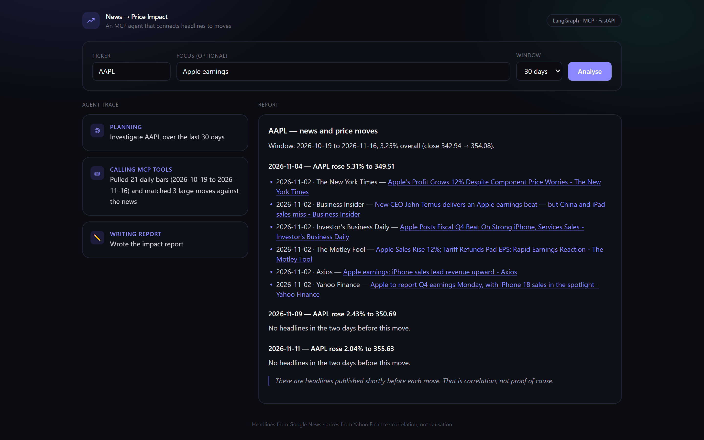
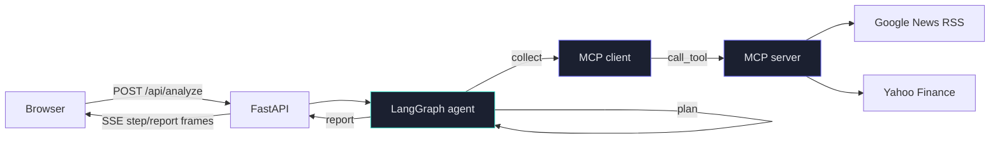

<div align="center">

# News → Price Impact

**An agent that reads the news, checks what the price did next, and shows you the headlines behind each move.**

Built on the Model Context Protocol · LangGraph · FastAPI · Next.js

[](backend/pyproject.toml)
[](backend/app/mcp_server.py)
[](frontend/package.json)
[](backend/tests)



</div>

---

## What it does

Ask about a ticker. The agent plans, calls its tools over **MCP**, and writes a
report that pairs every large price move with the headlines published in the two
days before it.

```
plan      → what to investigate and over which window
collect   → MCP call: correlate(symbol, query, days)
report    → markdown with dates, percentages and source links
```

Every step streams to the browser while it happens, so the work is visible
instead of hidden behind a spinner.

The report ends with the sentence that keeps it honest: *these are headlines
published shortly before each move — correlation, not proof of cause.*

## The MCP part

The tools are not private helper functions. They are an **MCP server**
([`backend/app/mcp_server.py`](backend/app/mcp_server.py)) that any MCP host can
mount:

```bash
cd backend
python -m app.mcp_server                 # stdio
python -m app.mcp_server --http 8765     # Streamable HTTP at http://127.0.0.1:8765/mcp
```

It exposes four tools:

| Tool | Returns |
|---|---|
| `search_news(query, days, limit)` | Headlines with source, date and URL |
| `price_history(symbol, days)` | Daily OHLC bars plus a window summary |
| `biggest_moves(symbol, days, threshold)` | Days that moved beyond a threshold |
| `correlate(symbol, query, days, lookback)` | Moves paired with the news before them |

The agent reaches them through a real `mcp.Client` session — in-process by
default, or over the network when `MCP_URL` is set. Set the same variable and the
graph talks to a server running somewhere else, with no code change.

## Architecture



## Quickstart

```bash
git clone https://github.com/MrFox2000/agentic-news-impact
cd agentic-news-impact

# terminal 1 - API and agent
cd backend
python -m venv .venv
.venv/bin/pip install -e ".[dev]"
.venv/bin/uvicorn app.main:app --reload --port 8001

# terminal 2 - UI
cd frontend
npm install
NEXT_PUBLIC_API_URL=http://127.0.0.1:8001 npm run dev -- -p 3001
```

Open <http://127.0.0.1:3001> and try `AAPL` or `BTC-USD`.

**No API keys are needed.** Both data sources are public and keyless. The LLM is
optional: without `OPENAI_API_KEY` the report is generated from a deterministic
template (the one in the screenshot), and every number and link in it is real.

```bash
# optional: real generated prose instead of the template
echo "OPENAI_API_KEY=sk-..." >> backend/.env
```

## Offline mode

```bash
OFFLINE=1 uvicorn app.main:app
```

Swaps both providers for deterministic fixtures. The test suite runs entirely in
this mode, so CI is hermetic and never rate-limited.

## API

| Method | Path | Description |
|---|---|---|
| `GET` | `/health` | Agent mode, LLM availability, data mode |
| `GET` | `/api/tools` | The tools exactly as the MCP server advertises them |
| `POST` | `/api/analyze` | `{symbol, question?, days?}` → `text/event-stream` |

Event frames:

```jsonc
{"type": "step",   "node": "collect", "detail": "Pulled 21 daily bars ... matched 3 large moves"}
{"type": "report", "markdown": "## AAPL — news and price moves\n..."}
{"type": "error",  "message": "..."}
{"type": "done"}
```

## Tests

```bash
cd backend && python -m pytest
```

```
..........................                                               [100%]
```

Twenty-six tests across four layers:

- **analysis** — percentage changes, threshold filtering, sorting, lookback windows
- **sources** — Yahoo and CoinGecko payload parsing, missing closes, symbol routing
- **mcp** — the server is exercised through `mcp.Client`: tool listing, every tool's
  payload shape, threshold behaviour. No mocks of the protocol.
- **api** — SSE contract: steps arrive in order, the report precedes `done`

## Design decisions

**Why is the MCP server in the same repo as the agent?** Because the interesting
claim is that they are *separable*. The agent takes anything `mcp.Client` accepts —
the in-process server in tests, a URL in production — and the server is a normal
MCP server any host can mount. Same code, two topologies.

**Why is there a template instead of an LLM-only report?** A demo that needs a key
before it shows anything is a demo nobody runs. The template produces the exact
same structure — window, moves, headlines, caveat — from real data, so the repo is
useful before anyone signs up for anything.

**Why Google News RSS and Yahoo?** Both are keyless. Stooq was the first choice for
equities and is built for CSV downloads, but it now serves a bot-check page to
non-browser clients, so it is not dependable from a server.

## Project layout

```
backend/
  app/mcp_server.py   the MCP server: four tools, one job each
  app/agent.py        LangGraph plan -> collect -> report, via mcp.Client
  app/mcp_client.py   normalises tool results (structured or text JSON)
  app/analysis.py     moves, thresholds, lookback alignment
  app/sources/        Google News and Yahoo providers, plus fixture swaps
  tests/              26 tests, no network
frontend/
  src/app/page.tsx    form, run state, stream orchestration
  src/components/     agent trace, dependency-free markdown renderer
docs/screenshots/     images used in this README
```

## Limitations, stated plainly

- **Correlation only.** A headline near a move is not evidence of cause.
- **Daily closes.** Intraday reaction is invisible here.
- **Headline matching is by date window**, not semantic relevance to the move.
- **Not investment advice**, and not a trading signal.

## Roadmap

- [ ] Rank headlines by relevance to the move, not just date proximity
- [ ] Intraday bars for reaction timing
- [ ] Cache provider responses to a local sqlite file
- [ ] Deploy the MCP server separately and point `MCP_URL` at it

## License

MIT — see [LICENSE](LICENSE).
